

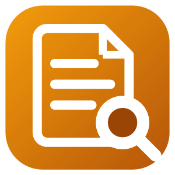

# FolioPeek

**PDF'leriniz için hızlı ve sade bir çalışma masası.** 
**A fast, simple desk for your PDFs.**

Açın, not alın, imzalayın, birleştirin · Tamamen bu bilgisayarda 
Open, annotate, sign and merge · Entirely on this PC

&nbsp;

[Türkçe](#türkçe) · [English](#english) · [Destek / Support](SUPPORT.md) · [Gizlilik / Privacy](PRIVACY.md)

 

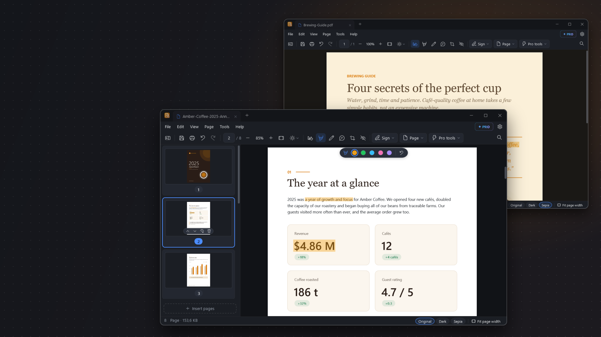

---

## Türkçe

Bir sözleşmeyi imzalamak, iki dosyayı tek PDF yapmak, bir rapora not düşmek… PDF'le her gün bir işiniz oluyor.
FolioPeek bunları hızlı, sade ve tamamen bilgisayarınızda yapar: dosyanızı bir web sitesine yüklemeniz, hesap açmanız
ya da abonelik ödemeniz gerekmez.

### Ücretsiz, sınırsız

- **Hızlı okuma:** sekmeler, içindekiler, Ctrl + F ile arama; Özgün, Koyu ve Sepya okuma modları
- **Not alma:** vurgulama, serbest çizim ve metin notu; renkler sayfanın üstündeki kapsülde, bir tık uzakta
- **Doldur ve imzala:** formları doldurun; imzanızı çizin, yazın ya da bir fotoğraftan ekleyin
- **Birleştirme tuvali:** PDF'leri deste deste yerleştirin, sayfaları desteler arasında sürükleyin, sırayı kablolarla kurun; ya da klasik listeyle tek tıkla birleştirin
- **Sayfa düzenleme:** döndürün, sıralayın, silin, ayırın, başka PDF'lerden sayfa ekleyin
- **Görsellerden PDF**, PDF'ten PNG/JPEG
- **Belge özellikleri (Ctrl + D):** başlık, yazar, oluşturan uygulama gibi gizli bilgileri görün
- **Yazdırma;** her adım Ctrl + Z ile geri alınır

### Pro: iş belgeleri için, tek seferlik (abonelik yok)

- **Kalıcı karartma:** işaretlediğiniz alanların altındaki metin, çizim ve görseller dosyadan gerçekten silinir ve sonuç denetlenir; asıl belgeniz değişmez
- **Yazı tanıma:** taranmış sayfadan metni kopyalayın, aranabilir PDF kaydedin; Windows'un kendi yazı tanımasıyla, çevrimdışı
- **Parola ve gizlilik:** AES ile şifreleme; meta verileri düzenleme ve temizleme
- **Filigran,** sayfa numarası, üst ve alt bilgi

### Dosyalarınız sizde kalır

FolioPeek internete hiç bağlanmaz; uygulama paketinde ağ izni bile yoktur. Hesap, reklam, telemetri yok.
Siz kaydetmedikçe dosyanız değişmez. Ayrıntılar: [Gizlilik politikası](PRIVACY.md).

Yaklaşık 3 MB · Windows 10 (2004) ve Windows 11 · Açık ve koyu tema · Türkçe ve İngilizce

### Ekran görüntüleri

<table>
  <tr>
    <td><a href="assets/screenshots/tr-1.png">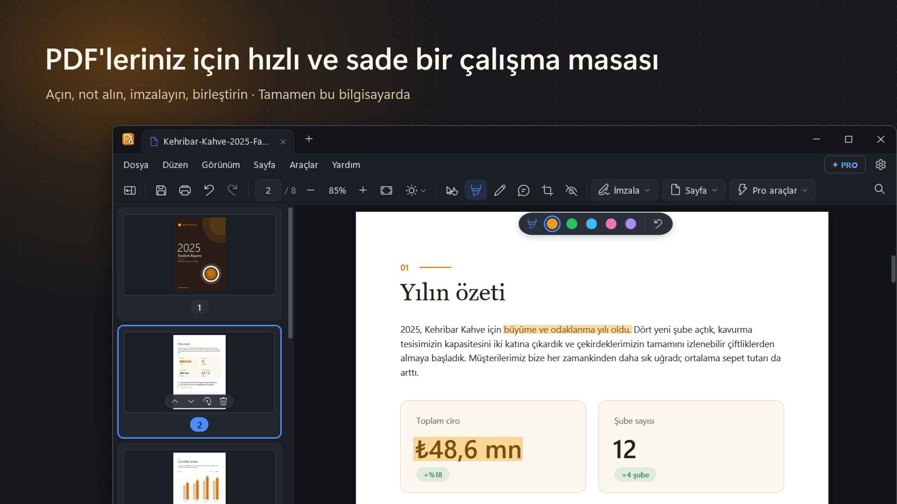</a></td>
    <td></td>
  </tr>
  <tr>
    <td><a href="assets/screenshots/tr-3.png">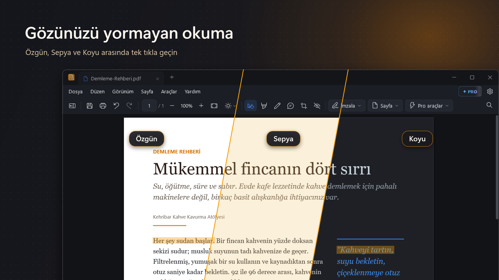</a></td>
    <td><a href="assets/screenshots/tr-4.png">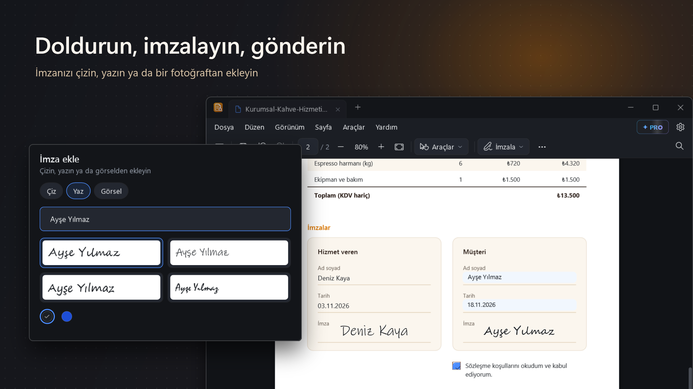</a></td>
  </tr>
  <tr>
    <td><a href="assets/screenshots/tr-5.png">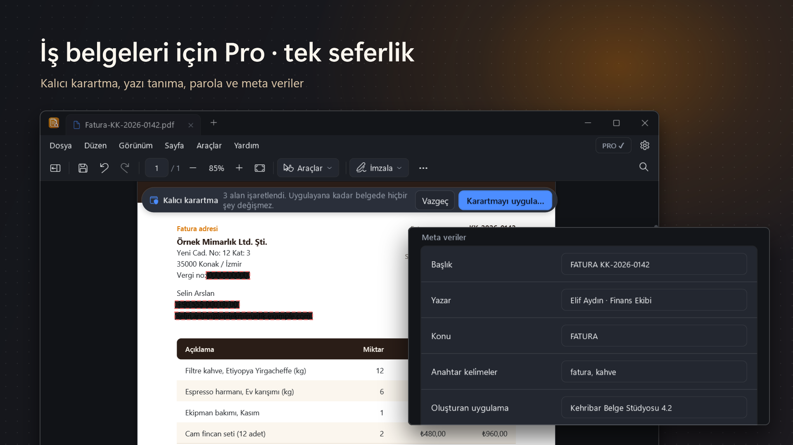</a></td>
    <td><a href="assets/screenshots/tr-6.png">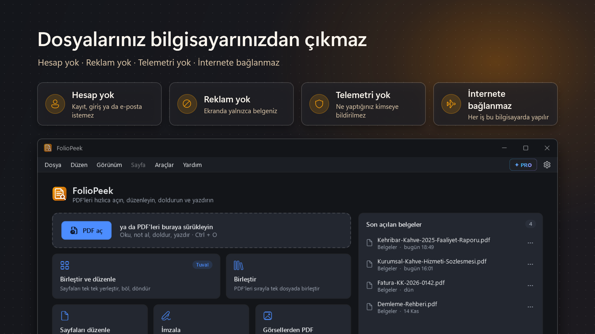</a></td>
  </tr>
</table>

---

## English

Signing a contract, turning two files into one PDF, adding a note to a report… PDFs are part of every day.
FolioPeek does these jobs fast, simply and entirely on your PC: no uploading files to a website, no account,
no subscription.

### Free, without limits

- **Fast reading:** tabs, bookmarks, Ctrl + F search; Original, Dark and Sepia reading modes
- **Notes:** highlights, freehand ink and text notes; colours one click away in the pill above the page
- **Fill and sign:** fill in forms; draw your signature, type it or add it from a photo
- **Merge board:** lay out PDFs as decks, drag pages between them, wire the order with cables; or merge with the classic list in one click
- **Page editing:** rotate, reorder, delete, extract, insert pages from other PDFs
- **Images to PDF**, PDF to PNG/JPEG
- **Document properties (Ctrl + D):** see hidden details such as title, author and the app that created the file
- **Printing;** every step can be undone with Ctrl + Z

### Pro: for business documents, one-time (no subscription)

- **Permanent redaction:** text, drawings and images under the areas you mark are really removed from the file, and the result is checked; your original stays unchanged
- **Text recognition:** copy text from scanned pages and save searchable PDFs, with the text recognition built into Windows, offline
- **Password and privacy:** AES encryption; edit and clear metadata
- **Watermarks,** page numbers, headers and footers

### Your files stay with you

FolioPeek never goes online; its package does not even have network permission. No account, ads or telemetry.
Your file only changes when you save. Details: [Privacy policy](PRIVACY.md).

About 3 MB · Windows 10 (2004) and Windows 11 · Light and dark themes · Turkish and English

### Screenshots

<table>
  <tr>
    <td><a href="assets/screenshots/en-1.png">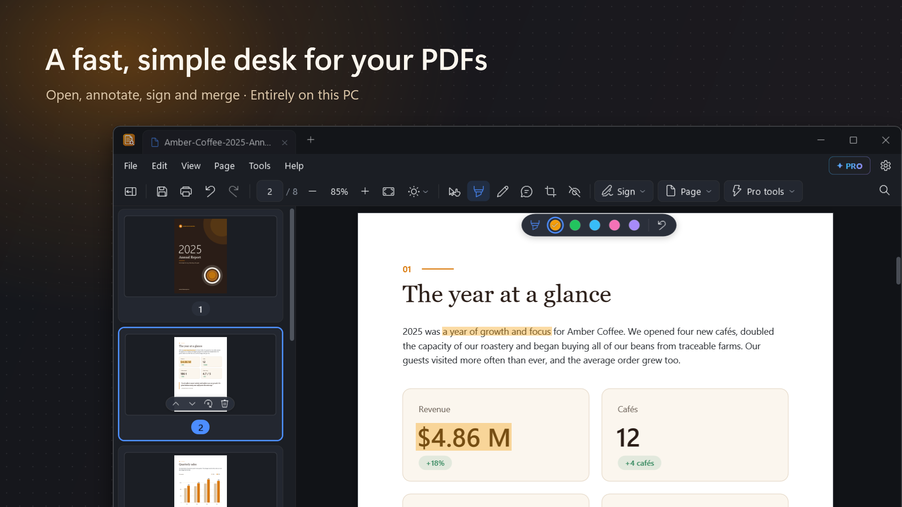</a></td>
    <td><a href="assets/screenshots/en-2.png">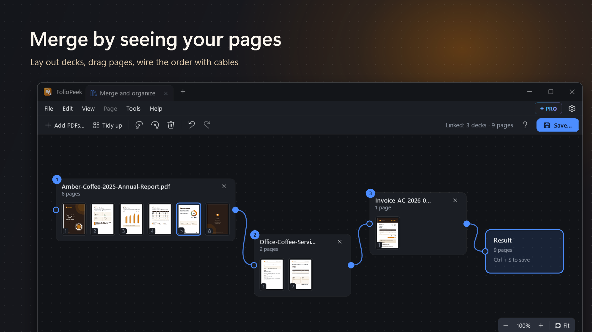</a></td>
  </tr>
  <tr>
    <td><a href="assets/screenshots/en-3.png">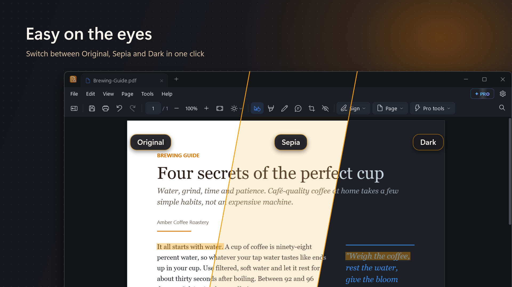</a></td>
    <td><a href="assets/screenshots/en-4.png">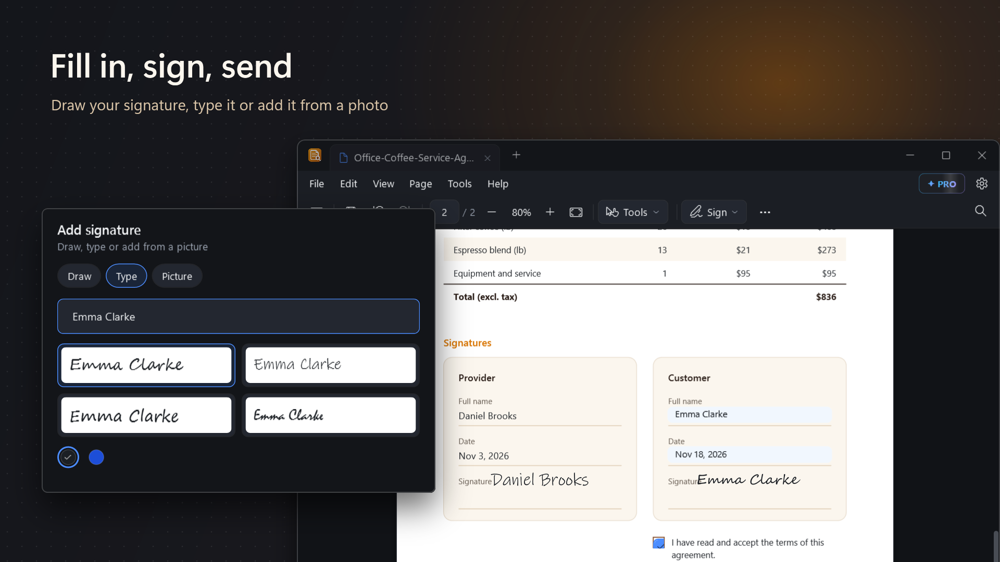</a></td>
  </tr>
  <tr>
    <td><a href="assets/screenshots/en-5.png">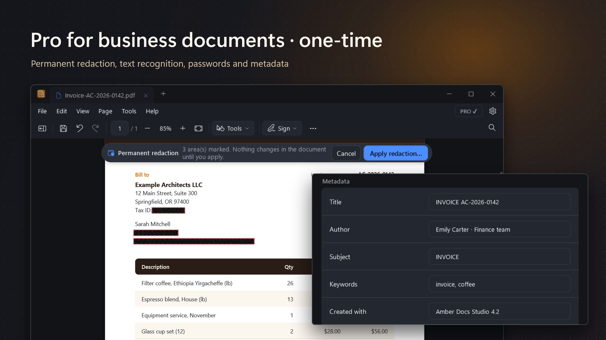</a></td>
    <td><a href="assets/screenshots/en-6.png">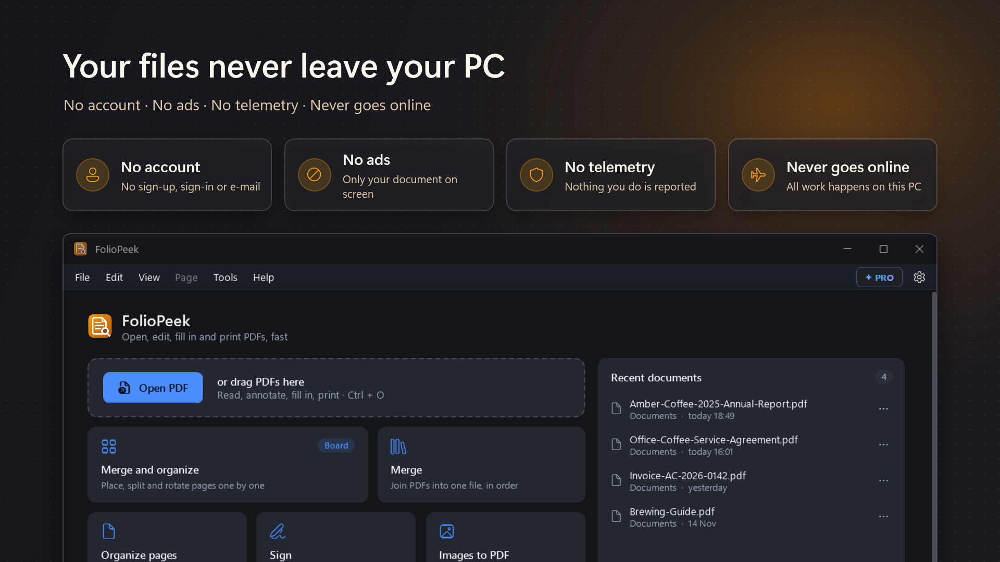</a></td>
  </tr>
</table>

---

## Bu repo / This repo

FolioPeek kapalı kaynaklıdır ve bağımsız bir geliştiricinin işidir. Bu repo yalnızca gizlilik politikasını, belgeleri ve
sorun bildirimlerini barındırır; kaynak kod veya kurulum dosyası içermez. Sorun ve önerileriniz için
[buradan bildirebilirsiniz](https://github.com/umitkrkmz/FolioPeek/issues/new/choose); güvenlik açıkları için
[SECURITY.md](SECURITY.md).

FolioPeek is closed source, made by an independent developer. This repo holds only the privacy policy, documentation and
the issue tracker; it contains no source code or installers. Problems and ideas:
[report them here](https://github.com/umitkrkmz/FolioPeek/issues/new/choose); security issues: [SECURITY.md](SECURITY.md).

## Lisans / License

Bu repodaki belgeler [CC BY 4.0](LICENSE) lisanslıdır. **FolioPeek adı, logosu ve uygulamanın kendisi (ekran
görüntüleri dahil) bu lisansa dahil değildir.** Ekran görüntülerindeki belgeler, kişiler ve rakamlar uydurmadır.
Kullanılan açık kaynak bileşenler: [THIRD-PARTY-NOTICES.txt](THIRD-PARTY-NOTICES.txt).

The documents in this repo are licensed under [CC BY 4.0](LICENSE). **The FolioPeek name, logo and the app itself
(including its screenshots) are not covered by this license.** The documents, people and figures in the screenshots are
made up. Open-source components used: [THIRD-PARTY-NOTICES.txt](THIRD-PARTY-NOTICES.txt).
