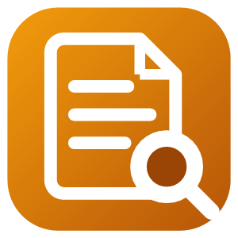

# FolioPeek — Yardım ve destek / Help and support

[Türkçe](#türkçe) · [English](#english)

📧 [zeynelumitkorkmaz@gmail.com](mailto:zeynelumitkorkmaz@gmail.com?subject=FolioPeek) · 🐞 [Sorunlar / Issues](https://github.com/umitkrkmz/FolioPeek/issues) · 🔒 [Gizlilik / Privacy](PRIVACY.md)

---

## Türkçe

**İçindekiler:** [Bize ulaşın](#bize-ulaşın) · [Başlarken](#başlarken) · [Okuma](#okuma) · [Notlar](#notlar) ·
[Doldur ve imzala](#doldur-ve-imzala) · [Birleştirme](#birleştirme) · [Sayfa düzenleme](#sayfa-düzenleme) ·
[Görseller](#görseller) · [Belge özellikleri](#belge-özellikleri) · [Yazdırma](#yazdırma) · [Pro](#pro) · [Gizlilik](#gizlilik) ·
[Sorun giderme](#sorun-giderme) · [Klavye kısayolları](#klavye-kısayolları)

### Bize ulaşın

FolioPeek bağımsız bir geliştiricinin işidir; her mesajı okuyorum ve en kısa sürede yanıtlamaya çalışıyorum.

| Ne için | Nereden |
|---|---|
| Soru, sorun, öneri, satın alma | 📧 E-posta: [zeynelumitkorkmaz@gmail.com](mailto:zeynelumitkorkmaz@gmail.com?subject=FolioPeek) |
| Herkese açık sorun bildirimi | 🐞 [github.com/umitkrkmz/FolioPeek/issues](https://github.com/umitkrkmz/FolioPeek/issues) — okumak serbest; yeni bildirim için ücretsiz GitHub hesabı gerekir |
| Güvenlik açığı | 🔒 Herkese açık bildirim açmayın; [SECURITY.md](SECURITY.md)'deki yolu izleyin |

Yazarken şunları eklemeniz işimi kolaylaştırır: Windows sürümü, FolioPeek sürümü (*Ayarlar → Hakkında*), ne yaptığınız ve
ne olduğu, varsa bir ekran görüntüsü. **Belgenizi göndermeyin;** kişisel bilgi içerebilir. Sorun yalnızca belirli bir
dosyada çıkıyorsa önce bana yazın, birlikte güvenli bir yol buluruz.

### Başlarken

- **PDF açmak:** *Dosya → PDF aç…* (Ctrl + O), giriş ekranındaki **PDF aç** düğmesi ya da dosyaları pencereye sürükleyip
  bırakmak. Her belge kendi sekmesinde açılır; Ctrl + W sekmeyi kapatır.
- **PDF'leri çift tıklayınca FolioPeek'te açmak:** *Ayarlar → Genel → Varsayılan PDF uygulaması* düğmesi Windows
  ayarlarını açar; orada ".pdf" için FolioPeek'i seçin.
- **Giriş ekranı:** son açılan belgeler ve sık işler (birleştir, sayfaları düzenle, imzala, görsellerden PDF, PDF'ten
  görsel) tek tıkla burada.
- **Kaydetmek:** Ctrl + S aynı dosyaya, Ctrl + Shift + S yeni bir dosyaya kaydeder. Siz kaydetmedikçe dosyanız değişmez;
  kaydedilmemiş değişiklik varken sekme adının başında `*` görünür.

### Okuma

- **Okuma modları:** **Özgün**, **Koyu** ve **Sepya**; durum çubuğundan ya da *Görünüm → Okuma modu* menüsünden. Mod
  yalnızca ekranda değişir, dosyaya yazılmaz. Varsayılan modu *Ayarlar → Okuma → Varsayılan okuma teması*'ndan seçebilirsiniz.
- **Arama:** Ctrl + F; sonraki / önceki eşleşme F3 / Shift + F3; Esc kapatır.
- **Yakınlaştırma:** Ctrl + fare tekerleği ya da Ctrl + + / Ctrl + -; Ctrl + 0 gerçek boyut (%100);
  *Görünüm → Sayfa genişliğine sığdır*.
- **Gezinme:** Ctrl + G ile sayfaya gidin; F4 kenar çubuğunu (küçük resimler ve içindekiler) açıp kapatır.
  Sayfada orta tık otomatik kaydırmayı başlatır.
- **Metin kopyalamak:** metni seçip Ctrl + C; *Düzen → Bu sayfadaki tüm metni seç* (Ctrl + A).
- **Web'de aramak:** metni seçip sağ tıklayın → *Bing ile ara: "…"*. Arama varsayılan tarayıcınızda açılır; arama motorunu
  *Ayarlar → Okuma → Web'de arama*'dan seçin (Bing, Google, DuckDuckGo). Seçimin en fazla ilk 200 karakteri aranır.

### Notlar

- Araç çubuğunda ve *Araçlar* menüsünde: **Vurgula**, **Serbest çizim**, **Metin notu** ve **Bölgeyi panoya kopyala**
  (seçtiğiniz alanı resim olarak panoya alır).
- Renkler sayfanın üstünde beliren kapsülde; her adım Ctrl + Z ile geri alınır, Ctrl + Y ile yinelenir.
- Notlar gerçek PDF notu olarak kaydedilir; Edge, Acrobat gibi başka uygulamalarda da görünür.
- *Görünüm → Tüm notları gizle* notları geçici olarak gizler. Not rengi ve yazar adı *Ayarlar → Notlar*'dadır.
- Bir **vurguya sağ tıklayınca** küçük bir menü açılır: *Vurguyu sil* ya da *Notlarıma kaydet*. Serbest çizim ve metin notu
  sağ tıkla hemen silinir (Ctrl + Z geri getirir).

### Notlarım

Belgelerden alıntıları tek bir not defterinde toplayın (alıntı eklemek Pro'dadır; kaydedilmiş notları okumak, açmak, silmek
ve dışa aktarmak her zaman ücretsizdir).

- **Kaydetmek:** metni seçip sağ tıklayın ya da bir vurguya sağ tıklayın → *Notlarıma kaydet*. Aynı alıntı iki kez kaydedilmez.
- **Açmak:** Ctrl + Shift + N, *Araçlar → Notlarım*, *Pro araçlar → Notlarım* ya da giriş ekranındaki **Notlarım** kartı.
  Pencere açık kalır; belgeyle yan yana çalışabilirsiniz.
- Notlar belgeye göre gruplanır. Her alıntının altına kendi **yorumunuzu** yazabilirsiniz; **Sayfaya git** belgeyi açar, alıntının
  olduğu yere kaydırır ve alıntıyı birkaç saniye parlatır. Silinen bir not *Geri al* ile geri gelir.
- **Dışa aktar:** Markdown (`.md`) ya da metin (`.txt`). Arama kutusu doluysa yalnızca bulunan notlar aktarılır.
- Notlar yalnızca bu bilgisayarda tutulur ve **FolioPeek kaldırılınca silinir**; saklamak ya da başka bir bilgisayara taşımak
  için dışa aktarın.

### Doldur ve imzala

- **Form doldurmak:** formlu PDF'lerde alanlar sayfanın üstünde doldurulabilir kutular olarak görünür; yazın, kutucukları
  işaretleyin ve kaydedin.
- **İmza eklemek:** araç çubuğunda **İmzala** ya da *Araçlar → İmza ekle…*. İmzanızı **çizin**, adınızı **yazıp** bir el
  yazısı seçin ya da bir **görselden** (fotoğraf, tarama) ekleyin. Yerleştirdikten sonra taşıyıp boyutlandırabilirsiniz.
- **Tarih ve metin:** *Araçlar → Bugünün tarihini ekle* ve *Metin ekle…*.
- İmza bilgisayarda saklanmaz; uygulama açıkken **Son imzayı kullan** ile yeniden eklenebilir. Kaydettiğinizde imza
  sayfanın parçası olur.

### Birleştirme

İki yol var, ikisi de ücretsiz:

- **PDF'leri birleştir…** (*Dosya* menüsü): dosyaları bir listeye ekleyin, sıralayın, tek tıkla birleştirin.
- **Birleştir ve düzenle (tuval)…**: her PDF bir deste olarak görünür. Sayfaları desteler arasında sürükleyin, döndürün,
  çıkarın; desteleri kablolarla **Sonuç** kartına bağlayarak sırayı kurun; Ctrl + S ile kaydedin.
  Tuval klavyeyle de kullanılır: Tab desteler, ← → sayfalar arasında gezinir; Enter desteyi sonuca bağlar ya da ayırır;
  X seçili sayfalardan yeni deste yapar; R / Shift + R döndürür; Delete çıkarır.

Birleştirmede içindekiler, belge içi bağlantılar, form alanları ve notlar korunur.

### Sayfa düzenleme

- *Sayfa* menüsünde ve kenar çubuğundaki küçük resimlerde: **Sola / Sağa döndür**, **Sayfayı sil**, sıralama,
  **Sayfa ekle…** (başka PDF'lerden) ve **Sayfaları yeni PDF olarak ayır…**.
- Kenar çubuğunda birden çok sayfa seçip birlikte işlem yapabilirsiniz.

### Görseller

- **Görsellerden PDF…** (*Dosya*): PNG, JPEG ve BMP görsellerden yeni bir PDF.
- **Sayfaları görsel olarak kaydet…**: tüm sayfalar, bu sayfa, seçili sayfalar ya da bir aralık (örnek: `1-3, 5, 8-`);
  PNG veya JPEG, 150 ya da 300 DPI; isterseniz notlarla birlikte.

### Belge özellikleri

*Dosya → Belge özellikleri…* (Ctrl + D): dosya adı, sayfa sayısı, boyut, PDF sürümü, tarihler ve belgede saklanan başlık,
yazar, konu, anahtar kelimeler, oluşturan uygulama. Görmek ücretsizdir; düzenlemek ve temizlemek Pro'dadır.

### Yazdırma

*Dosya → Yazdır…* (Ctrl + P) FolioPeek'in yazdırma penceresini açar: solda **canlı önizleme**, sağda ayarlar. Önizlemede ne
görüyorsanız kağıda o basılır.

- **Önizleme:** tekerlekle kağıtlar arasında kaydırın, Ctrl + tekerlek ya da sağ alttaki düğmelerle yakınlaştırın. Kağıtlar
  sığınca ikişer yan yana gösterilir.
- **Yazıcı:** varsayılan ya da en son kullandığınız yazıcı seçili gelir. Yanındaki nokta Windows'un bildirdiği durumu gösterir:
  yeşil hazır, sarı çevrimdışı ya da duraklatılmış (iş sıraya alınır), kırmızı dikkat istiyor (kağıt, kapak ya da bir hata).
  Yazıcı yeni kapatıldıysa Windows bunu biraz geç fark edebilir.
- **Sayfalar:** tümü, **bu sayfa** (önizlemede gördüğünüz sayfa), kenar çubuğunda seçili sayfalar ya da bir aralık (`1-3, 5, 8-`).
- **Yön:** *Otomatik* her sayfayı kendi yönüyle kağıda oturtur; Dikey ya da Yatay seçerseniz sayfalar döndürülmez, küçültülür.
- **İki taraflı** (yazıcınız destekliyorsa): *Kitap gibi* — kağıt yana çevrilince arka yüz düz okunur; *Takvim gibi* — yukarı
  çevrilince. FolioPeek kağıdın hangi kenarından döneceğini (uzun ya da kısa) sayfa yönüne göre kendisi seçer.
- **Daha fazla ayar:** kağıt boyutu ve türü, baskı kalitesi (ör. Taslak hızlı basar), yaprak başına 1-2-4-6-9 sayfa (slaytlar
  için: 2 slayt dik kağıda alt alta, 4 slayt yatay kağıda 2 × 2), ölçek, kenar boşluğu, notlar, ters sıra ve **tarih ve saat**
  (yalnızca kağıtta; dosya değişmez).
- **Ölçek:** varsayılan *Gerçek boyut*tur; A4 belge A4 kağıda birebir oturur ve yalnızca yazıcının basamadığı birkaç milimetrelik
  kenar kesilir. **Yazıcınız kenardaki çizgileri kesiyorsa** *Kağıda sığdır*'ı seçin, ölçeği %95 yapın ya da kenar boşluğunu
  *Normal (10 mm)* seçin.
- Seçimleriniz **her yazıcı için ayrı hatırlanır** (hangi sayfalar ve kaç kopya her seferinde yeniden seçilir).
- Windows'un kendi yazdırma penceresini tercih ederseniz: pencerenin altındaki bağlantı ya da **Ctrl + Shift + P**.

### Pro

Pro, iş belgeleriyle uğraşanlar için **tek seferlik** bir satın almadır; abonelik yoktur.

- **Satın almak:** sağ üstteki **PRO** düğmesi Ücretsiz/Pro karşılaştırmasını açar; **Pro'yu satın al** Microsoft Store
  üzerinden ödemeyi başlatır. Satın alma Microsoft hesabınıza bağlıdır.
- **Başka bir bilgisayarda ya da yeniden kurduktan sonra:** aynı Microsoft hesabıyla Store'a girin; *PRO → Satın alımı
  geri yükle* ya da *Ayarlar → Pro → Satın alımı geri yükle*.
- **Pro araçlar** (araç çubuğundaki *Pro araçlar* ve *Araçlar* menüsü):
  - **Karart:** gizlenecek alanları sayfalar üzerinde sürükleyerek işaretleyin (sağ tık bir işareti siler), sonra
    **Karartmayı uygula…**. Altındaki metin, çizim ve görseller dosyadan gerçekten silinir ve sonuç denetlenir.
    İşaretli sayfalar görüntüye dönüşür; alan dışındaki metin aranabilir kalır. Sonuç yeni bir dosyaya kaydedilir.
  - **Yazı tanıma:** *Bu sayfanın yazısını kopyala* ve *Taranmış PDF'i aranabilir yap…*. Windows'un kendi yazı
    tanımasıyla, çevrimdışı çalışır; dil *Ayarlar → Yazı tanıma*'dan seçilir.
  - **Parola ve gizlilik:** belgeyi parolayla koruyun (AES-128), parolayı kaldırın ya da başlık, yazar gibi gizli
    bilgileri silin. Hepsi yeni bir kopya kaydeder; açık belge değişmez.
  - **Filigran ve sayfa numarası:** filigran, sayfa numarası, üst ve alt bilgi; önizlemeli.
  - **Meta veri düzenleme:** *Belge özellikleri* penceresinde.

### Gizlilik

FolioPeek internete hiç bağlanmaz; uygulama paketinde ağ izni yoktur. Hesap, reklam, telemetri yok. Belgeleriniz,
ayarlarınız, Notlarım ve son açılanlar listesi yalnızca bu bilgisayarda kalır. *Web'de ara* yalnızca siz tıklayınca
tarayıcınızı açar. Pro satın alma ve geri yükleme işlemlerini Microsoft
Store yapar. Tüm ayrıntılar: [Gizlilik politikası](PRIVACY.md).

### Sorun giderme

<b>Belge açılmıyor ya da bazı sayfalar boş görünüyor</b>

Dosya bozuk ya da parola korumalı olabilir; parola istenirse belgenin parolasını girin. Başka bir PDF'in açılıp
açılmadığını deneyin. Sorun sürerse [e-postayla](mailto:zeynelumitkorkmaz@gmail.com?subject=FolioPeek%20-%20belge%20a%C3%A7%C4%B1lm%C4%B1yor)
bildirin (belgenizi göndermeden).

<b>"Bu belgenin sahibi düzenlemeyi kısıtlamış" uyarısı</b>

Bazı PDF'ler okunabilir ama yazarı düzenlemeyi kısıtlamıştır. FolioPeek bu kısıtlamayı aşmaz; düzenlemek için belgenin
izin parolası gerekir.

<b>Yazı tanıma çalışmıyor ya da "yüklü dil yok" diyor</b>

Windows'un yazı tanıması, belgenin dili için bir dil paketi ister: *Windows Ayarları → Saat ve dil → Dil ve bölge*
bölümünden o dili ekleyin, sonra FolioPeek'te *Ayarlar → Yazı tanıma*'dan seçin.

<b>Pro satın aldım ama uygulama görmüyor</b>

Microsoft Store'a satın alırken kullandığınız Microsoft hesabıyla girdiğinizden emin olun, sonra *PRO → Satın alımı
geri yükle*'yi deneyin. Bu adım için internet bağlantısı gerekir (bağlanan Microsoft Store'dur, FolioPeek değil).
Olmazsa [e-postayla](mailto:zeynelumitkorkmaz@gmail.com?subject=FolioPeek%20Pro) yazın.

<b>Yazıcı kenardaki çizgileri ya da yazıları kesiyor</b>

Yazdırma penceresinde *Daha fazla ayar → Ölçek*'ten *Kağıda sığdır*'ı seçin ya da ölçeği %95 yapın; gerekirse kenar boşluğunu
*Normal (10 mm)* seçin. Önizleme, kağıda tam olarak ne basılacağını gösterir.

<b>İmzam kaydedildi mi?</b>

Hayır. İmza yalnızca uygulama açıkken bellekte tutulur ve uygulamayı kapatınca silinir. Bir belgeye yerleştirip
kaydettiğinizde o belgenin parçası olur.

<b>Vurgu ve notlarım başka bir PDF uygulamasında görünmüyor</b>

Önce belgeyi kaydettiğinizden emin olun (sekme adının başında `*` kalmamalı). Notlar standart PDF notu olarak yazılır; yine de
görünmüyorsa hangi uygulamada açtığınızı yazarak bildirin.

<b>PDF'ler hâlâ başka bir uygulamada açılıyor</b>

*Ayarlar → Genel → Varsayılan PDF uygulaması* düğmesiyle Windows ayarlarını açın ve ".pdf" için FolioPeek'i seçin.

### Klavye kısayolları

| Kısayol | İş |
|---|---|
| Ctrl + O | PDF aç |
| Ctrl + S / Ctrl + Shift + S | Kaydet / Farklı kaydet |
| Ctrl + P | Yazdır (önizlemeli) |
| Ctrl + Shift + P | Windows yazdırma penceresiyle yazdır |
| Ctrl + D | Belge özellikleri |
| Ctrl + Shift + N | Notlarım |
| Ctrl + W | Belgeyi kapat |
| Ctrl + Z / Ctrl + Y | Geri al / Yinele |
| Ctrl + C / Ctrl + A | Kopyala / Bu sayfadaki tüm metni seç |
| Ctrl + F, F3 / Shift + F3 | Bul, sonraki / önceki eşleşme |
| Esc | Aramayı veya otomatik kaydırmayı kapat |
| Ctrl + G | Sayfaya git |
| Ctrl + + / Ctrl + -, Ctrl + 0 | Yakınlaştır / uzaklaştır, gerçek boyut |
| F4 | Kenar çubuğu |
| Ctrl + , | Ayarlar |
| Orta tık | Sayfada otomatik kaydırma; sekmede sekmeyi kapatma |

Tüm liste uygulamada: *Yardım → Klavye kısayolları*.

---

## English

**Contents:** [Contact](#contact) · [Getting started](#getting-started) · [Reading](#reading) · [Notes](#notes) ·
[Fill and sign](#fill-and-sign) · [Merging](#merging) · [Page editing](#page-editing) · [Images](#images) ·
[Document properties](#document-properties) · [Printing](#printing) · [Pro](#pro-1) · [Privacy](#privacy) ·
[Troubleshooting](#troubleshooting) · [Keyboard shortcuts](#keyboard-shortcuts)

### Contact

FolioPeek is made by an independent developer; I read every message and try to answer as soon as I can.

| For | Where |
|---|---|
| Questions, problems, ideas, purchases | 📧 E-mail: [zeynelumitkorkmaz@gmail.com](mailto:zeynelumitkorkmaz@gmail.com?subject=FolioPeek) |
| Public issue reports | 🐞 [github.com/umitkrkmz/FolioPeek/issues](https://github.com/umitkrkmz/FolioPeek/issues) — free to read; opening a new one needs a free GitHub account |
| Security issues | 🔒 Please do not open a public issue; follow [SECURITY.md](SECURITY.md) |

It helps to include: your Windows version, the FolioPeek version (*Settings → About*), what you did and what happened,
and a screenshot if you have one. **Please do not send your document;** it may contain personal information. If a
problem happens only with one file, write to me first and we will find a safe way.

### Getting started

- **Open a PDF:** *File → Open PDF…* (Ctrl + O), the **Open PDF** button on the home screen, or drag files onto the
  window. Each document opens in its own tab; Ctrl + W closes it.
- **Open PDFs in FolioPeek when you double-click them:** *Settings → General → Default PDF app* opens Windows settings;
  choose FolioPeek for ".pdf" there.
- **Home screen:** recent documents and common jobs (merge, organize pages, sign, images to PDF, PDF to images) are one
  click away.
- **Saving:** Ctrl + S saves to the same file, Ctrl + Shift + S to a new one. Your file only changes when you save; a `*`
  at the start of the tab name shows unsaved changes.

### Reading

- **Reading modes:** **Original**, **Dark** and **Sepia**, from the status bar or *View → Reading mode*. The mode
  changes only the screen, never the file. Choose the default in *Settings → Reading → Default reading theme*.
- **Search:** Ctrl + F; next / previous match F3 / Shift + F3; Esc closes it.
- **Zoom:** Ctrl + mouse wheel or Ctrl + + / Ctrl + -; Ctrl + 0 actual size (100%); *View → Fit page width*.
- **Moving around:** Ctrl + G goes to a page; F4 shows or hides the sidebar (thumbnails and bookmarks). Middle click
  on a page starts autoscroll.
- **Copying text:** select it and press Ctrl + C; *Edit → Select all text on this page* (Ctrl + A).
- **Searching the web:** select text, right-click → *Search Bing for "…"*. The search opens in your default browser; choose
  the engine in *Settings → Reading → Web search* (Bing, Google, DuckDuckGo). At most the first 200 characters are searched.

### Notes

- In the toolbar and the *Tools* menu: **Highlight**, **Freehand ink**, **Text note** and **Copy region to clipboard**
  (copies the area you choose as a picture).
- Colours are in the pill that appears above the page; every step can be undone with Ctrl + Z and redone with Ctrl + Y.
- Notes are saved as real PDF annotations, so they also show in other apps such as Edge or Acrobat.
- *View → Hide all notes* hides them for a while. Note colours and the author name are in *Settings → Notes*.
- **Right-clicking a highlight** opens a small menu: *Delete highlight* or *Save to my notes*. Freehand ink and text notes
  are deleted at once with a right-click (Ctrl + Z brings them back).

### My notes

Collect quotes from your documents in one notebook (adding a quote is Pro; reading, opening, deleting and exporting saved
notes are always free).

- **Saving:** select text and right-click, or right-click a highlight → *Save to my notes*. The same quote is not saved twice.
- **Opening:** Ctrl + Shift + N, *Tools → My notes*, *Pro tools → My notes*, or the **My notes** card on the home screen.
  The window stays open, so you can work beside the document.
- Notes are grouped by document. Write your own **comment** under each quote; **Go to page** opens the document, scrolls to
  the quote and makes it glow for a few seconds. A deleted note comes back with *Undo*.
- **Export:** Markdown (`.md`) or text (`.txt`). With text in the search box, only the notes found are exported.
- Notes are kept only on this PC and are **removed when FolioPeek is uninstalled**; export them to keep them or move them
  to another PC.

### Fill and sign

- **Filling in forms:** in PDFs with forms, the fields show as boxes on the page; type, tick the boxes and save.
- **Adding a signature:** **Sign** in the toolbar or *Tools → Add signature…*. **Draw** your signature, **type** your
  name and pick a handwriting style, or add it from a **picture** (a photo or a scan). Move and resize it after placing it.
- **Date and text:** *Tools → Add today's date* and *Add text…*.
- Your signature is not stored on your PC; while the app is open, **Use last signature** adds it again. When you save,
  the signature becomes part of the page.

### Merging

Two ways, both free:

- **Merge PDFs…** (*File* menu): add files to a list, put them in order, merge in one click.
- **Merge and organize (board)…**: each PDF shows as a deck. Drag pages between decks, turn or remove them, wire the
  decks to the **Result** card with cables to set the order, and save with Ctrl + S.
  The board also works with the keyboard: Tab moves between decks, ← → between pages; Enter links a deck to the result
  or unlinks it; X makes a new deck from the chosen pages; R / Shift + R turns them; Delete removes them.

Merging keeps bookmarks, links inside the document, form fields and notes.

### Page editing

- In the *Page* menu and on the sidebar thumbnails: **Rotate left / right**, **Delete page**, reordering,
  **Insert pages…** (from other PDFs) and **Extract pages as a new PDF…**.
- Choose several pages in the sidebar to work on them together.

### Images

- **Images to PDF…** (*File*): a new PDF from PNG, JPEG and BMP images.
- **Save pages as images…**: all pages, this page, the pages chosen in the sidebar or a range (for example `1-3, 5, 8-`);
  PNG or JPEG, 150 or 300 DPI; with or without notes.

### Document properties

*File → Document properties…* (Ctrl + D): file name, page count, size, PDF version, dates, and the title, author,
subject, keywords and creating app stored in the document. Viewing is free; editing and clearing are part of Pro.

### Printing

*File → Print…* (Ctrl + P) opens FolioPeek's print window: a **live preview** on the left, the settings on the right. What you
see in the preview is what is printed.

- **Preview:** scroll through the sheets with the wheel, zoom with Ctrl + wheel or the buttons at the bottom right. Sheets sit two
  side by side when they fit.
- **Printer:** your default or last used printer comes first. The dot shows what Windows reports: green ready, yellow offline or
  paused (the job waits), red needs attention (paper, cover or an error). Windows may notice a printer that was just switched off
  only after a while.
- **Pages:** all, **this page** (the page you see in the preview), the pages chosen in the sidebar, or a range (`1-3, 5, 8-`).
- **Orientation:** *Automatic* lays each page on the paper the way it is; with Portrait or Landscape pages are not turned, they
  shrink to fit.
- **Two-sided** (when your printer can): *Like a book* — the back reads upright when you turn the sheet sideways; *Like a
  calendar* — when you flip it upwards. FolioPeek picks the paper edge (long or short) from the page orientation.
- **More settings:** paper size and type, print quality (Draft prints fast), 1-2-4-6-9 pages per sheet (for slides: 2 stack on
  upright paper, 4 sit 2 × 2 on landscape paper), scale, margins, notes, reverse order and **date and time** (on paper only; the
  file does not change).
- **Scale:** *Actual size* by default; an A4 document lands exactly on A4 paper and only the few millimetres the printer cannot
  print are lost. **If your printer cuts lines at the edges**, choose *Fit to paper*, set the scale to 95% or choose *Normal
  (10 mm)* margins.
- Your choices are **remembered per printer** (which pages and how many copies are chosen each time).
- If you prefer the Windows print dialog: the link at the bottom of the window, or **Ctrl + Shift + P**.

### Pro

Pro is a **one-time** purchase for people who work with business documents; there is no subscription.

- **Buying:** the **PRO** button at the top right opens the Free/Pro comparison; **Get Pro** starts the payment through
  the Microsoft Store. The purchase belongs to your Microsoft account.
- **On another PC or after reinstalling:** sign in to the Store with the same Microsoft account, then use
  *PRO → Restore purchase* or *Settings → Pro → Restore purchase*.
- **Pro tools** (*Pro tools* in the toolbar and the *Tools* menu):
  - **Redact:** drag across the pages to mark the areas to hide (right-click removes a mark), then
    **Apply redaction…**. Text, drawings and images under them are really removed from the file, and the result is
    checked. Marked pages become images; text outside the areas stays searchable. The result is saved as a new file.
  - **Text recognition:** *Copy this page's text* and *Make a scanned PDF searchable…*. Uses the text recognition built
    into Windows, offline; choose the language in *Settings → Text recognition*.
  - **Password & privacy:** protect the document with a password (AES-128), remove a password, or delete hidden details
    such as title and author. Each saves a new copy; the open document does not change.
  - **Watermark & page numbers:** watermarks, page numbers, headers and footers, with a preview.
  - **Metadata editing:** in the *Document properties* window.

### Privacy

FolioPeek never goes online; its package does not even have network permission. No account, ads or telemetry. Your
documents, settings, My notes and the recent documents list stay on this PC only. *Search the web* opens your browser
only when you click it. Buying and restoring Pro is handled by the
Microsoft Store. Full details: [Privacy policy](PRIVACY.md).

### Troubleshooting

<b>A document does not open, or some pages look blank</b>

The file may be damaged or password-protected; if asked, enter the document's password. Check whether another PDF
opens. If it keeps happening, [e-mail me](mailto:zeynelumitkorkmaz@gmail.com?subject=FolioPeek%20-%20document%20does%20not%20open)
(without sending the document).

<b>"The author of this document restricted editing"</b>

Some PDFs can be read but their author has restricted editing. FolioPeek does not get around this; editing needs the
document's permissions password.

<b>Text recognition does not work, or says no language is installed</b>

Windows' text recognition needs a language pack for the document's language: add that language under
*Windows Settings → Time & language → Language & region*, then choose it in FolioPeek's *Settings → Text recognition*.

<b>I bought Pro but the app does not see it</b>

Make sure you are signed in to the Microsoft Store with the Microsoft account you bought it with, then try
*PRO → Restore purchase*. This step needs an internet connection (the Microsoft Store connects, not FolioPeek).
If it still does not work, [e-mail me](mailto:zeynelumitkorkmaz@gmail.com?subject=FolioPeek%20Pro).

<b>The printer cuts lines or text at the edges</b>

In the print window choose *More settings → Scale → Fit to paper*, or set the scale to 95%; if needed choose *Normal (10 mm)*
margins. The preview shows exactly what will be printed.

<b>Is my signature saved?</b>

No. It is kept in memory only while the app is open and is gone when you close it. Once you place it in a document and
save, it becomes part of that document.

<b>My highlights and notes do not show in another PDF app</b>

First make sure you saved the document (no `*` left at the start of the tab name). Notes are written as standard PDF annotations; if
they still do not show, let me know which app you opened it in.

<b>PDFs still open in another app</b>

Use *Settings → General → Default PDF app* to open Windows settings and choose FolioPeek for ".pdf".

### Keyboard shortcuts

| Shortcut | Action |
|---|---|
| Ctrl + O | Open PDF |
| Ctrl + S / Ctrl + Shift + S | Save / Save as |
| Ctrl + P | Print (with preview) |
| Ctrl + Shift + P | Print with the Windows dialog |
| Ctrl + D | Document properties |
| Ctrl + Shift + N | My notes |
| Ctrl + W | Close document |
| Ctrl + Z / Ctrl + Y | Undo / Redo |
| Ctrl + C / Ctrl + A | Copy / Select all text on this page |
| Ctrl + F, F3 / Shift + F3 | Find, next / previous match |
| Esc | Close find or stop autoscroll |
| Ctrl + G | Go to page |
| Ctrl + + / Ctrl + -, Ctrl + 0 | Zoom in / out, actual size |
| F4 | Sidebar |
| Ctrl + , | Settings |
| Middle click | Autoscroll on a page; closes a tab on a tab |

The full list is in the app: *Help → Keyboard shortcuts*.
